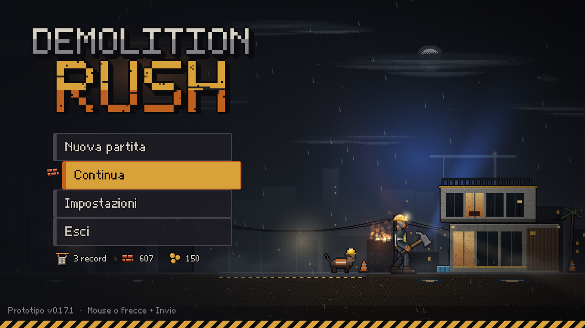
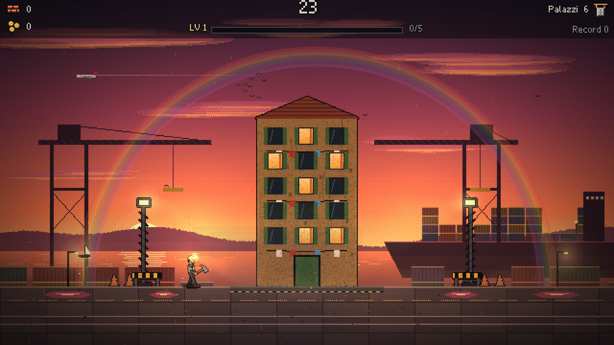
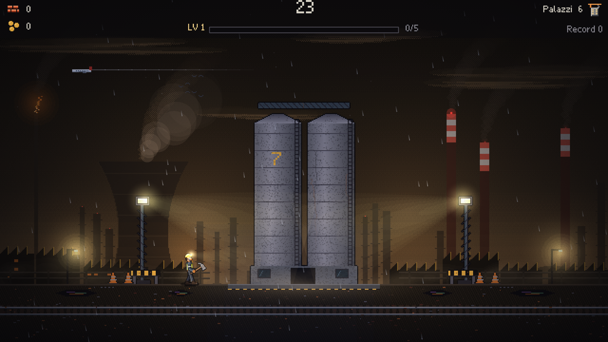
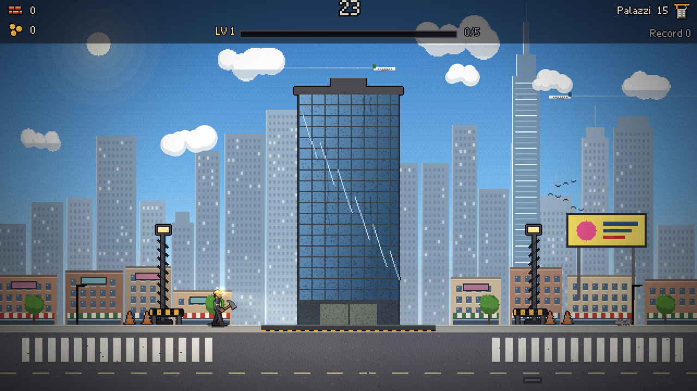
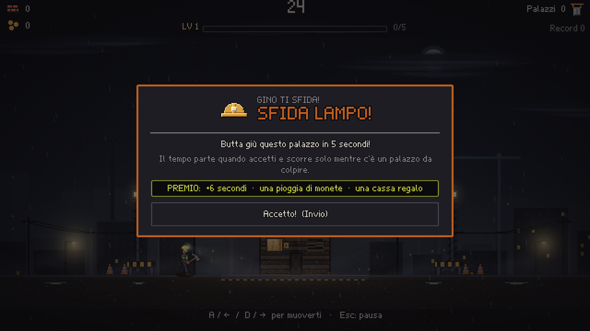
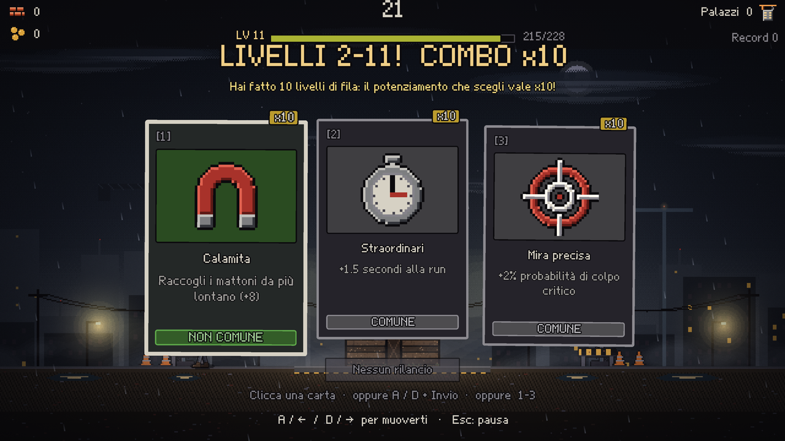
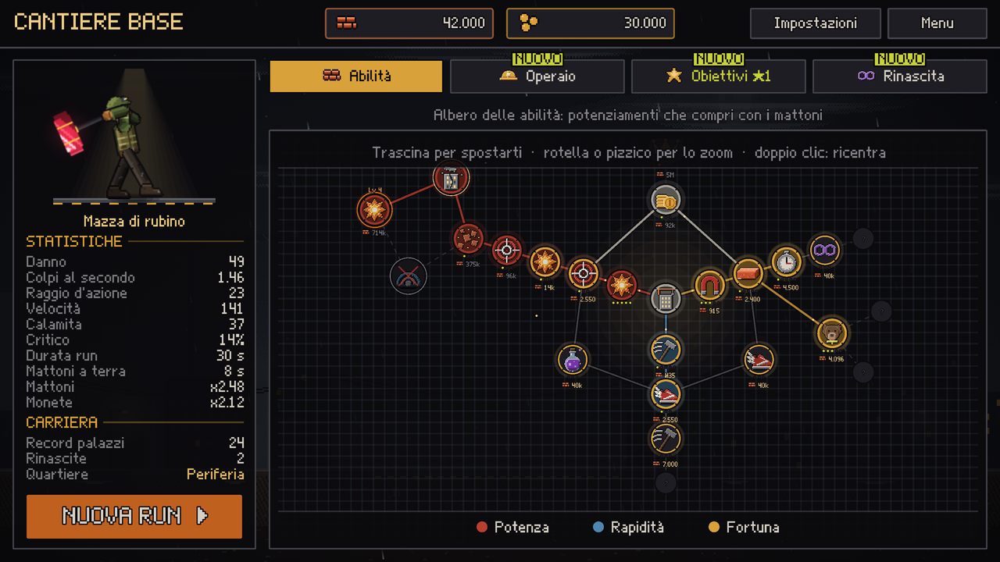
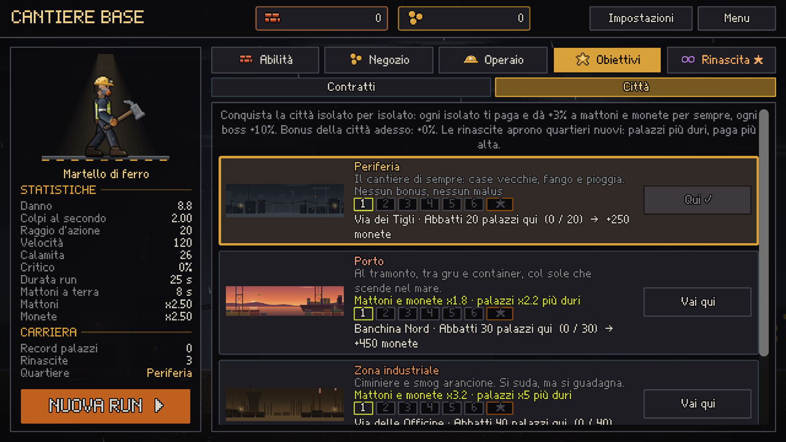
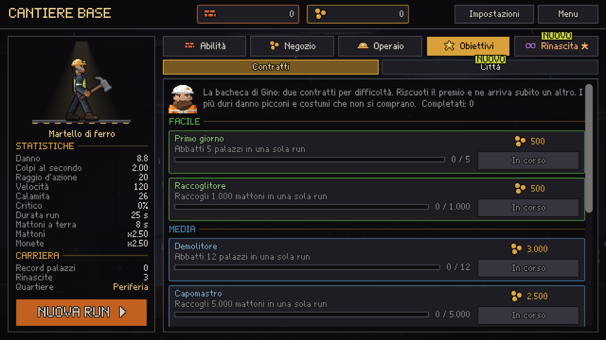

# Demolition Rush

Sei un operaio con il martello e la città è piena di palazzi da buttare giù. Hai pochi secondi per ogni giornata di lavoro: demolisci più palazzi che puoi, raccogli i mattoni che volano e scegli i potenziamenti quando sali di livello. A fine giornata torni al cantiere base e spendi quello che hai guadagnato per diventare più forte.

## ⬇️ Scarica (versione di prova 0.17.1)

| Sistema | Download |
|---|---|
| **Windows** (10 / 11, 64 bit) | [DemolitionRush_v0.17.1_windows.zip](https://github.com/ItsMisus/demolition-rush/releases/download/v0.17.1/DemolitionRush_v0.17.1_windows.zip) (54 MB) |
| **Mac** (chip Apple e Intel) | [DemolitionRush_v0.17.1_mac.zip](https://github.com/ItsMisus/demolition-rush/releases/download/v0.17.1/DemolitionRush_v0.17.1_mac.zip) (77 MB) |

Tutte le versioni, con l'elenco delle novità, sono nella pagina [Releases](https://github.com/ItsMisus/demolition-rush/releases).

**Novità della 0.17:** ogni quartiere ha 7 palazzi suoi (Conservificio e Capitaneria al Porto, Fonderia e Altoforno nella Zona industriale, Grandi magazzini e Grattacielo Art déco in Centro); si gioca anche col gamepad, la mappa della città con gli isolati da conquistare e il boss di ogni quartiere, le sfide di Gino, i messaggi della run in una colonna a destra e il cantiere base diviso in 5 sezioni. I salvataggi della versione precedente vanno bene.

### Come si avvia

**Windows**
1. Estrai lo zip.
2. Fai doppio clic su `DemolitionRush.exe`.
3. Se compare "Windows ha protetto il PC", clicca **Ulteriori informazioni → Esegui comunque**. Succede perché il gioco è nuovo e non ha una firma digitale.

**Mac**
1. Apri lo zip.
2. Trascina `Demolition Rush.app` in Applicazioni.
3. Avvia l'app. Se il Mac la blocca, clicca **Fine**, poi vai in **Impostazioni di Sistema → Privacy e sicurezza → Apri comunque**. Succede perché l'app non è registrata da Apple.

Dentro ogni zip c'è un file `LEGGIMI.txt` con tutti i dettagli.

## Comandi

| Azione | Tastiera | Gamepad |
|---|---|---|
| Muoversi | A / D oppure ← / → | levetta sinistra o croce |
| Colpire | automatico vicino al palazzo | automatico |
| Scegliere una carta | clic, 1–4, oppure frecce + Invio | croce + A (Y rilancia) |
| Scatto | Shift o Spazio (dopo averlo comprato) | B, X o RB |
| Pausa | Esc o P | Start |
| Cantiere base | Invio = nuova run | LB / RB cambiano sezione, Start = nuova run |

## Screenshot

## Dimmi cosa ne pensi

È una versione di prova. Mi interessa sapere:
- cosa ti è piaciuto e cosa ti ha annoiato;
- se a un certo punto non sapevi cosa fare;
- se le giornate di lavoro sono troppo corte o troppo lunghe;
- bug o cose strane, meglio con uno screenshot.

Puoi scrivermi direttamente oppure aprire una segnalazione nella scheda [Issues](https://github.com/ItsMisus/demolition-rush/issues).

---
Fatto con [Godot](https://godotengine.org). Musica e alcuni suoni sono di autori che li hanno resi liberi (CC0, CC BY, CC BY-SA): l'elenco completo con i crediti è in [CREDITS.md](CREDITS.md).
